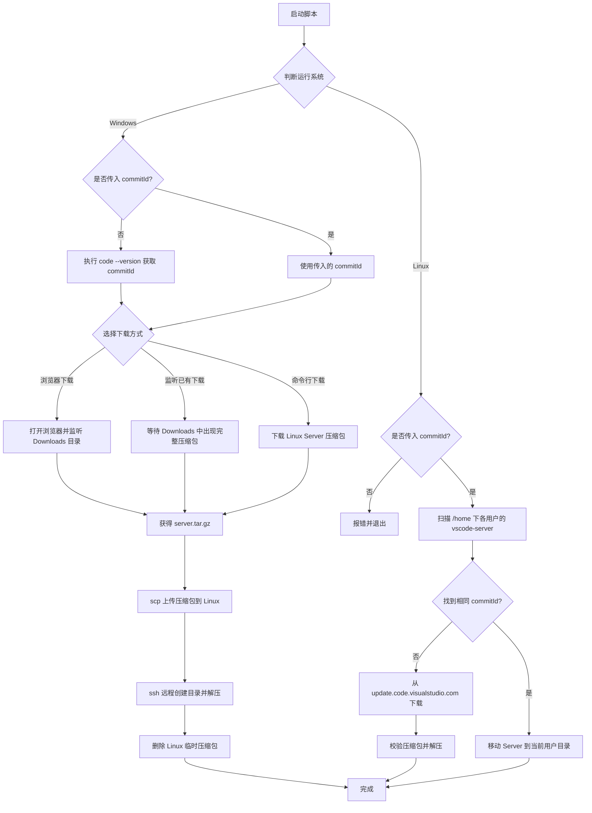

# VSCode Remote SSH Solution

面对 VSCode Remote SSH 连接远程服务器时，长期卡在 Downloading VS Code Server 的问题，提供了一个可在 windows 或 linux 上运行的脚本，帮助用户在远程服务器上手动安装 VSCode Server。

脚本流程图：

脚本思路来自[我只教一次！vscode remote-ssh 连接失败的基本原理和优雅的解决方案 - 知乎](https://zhuanlan.zhihu.com/p/671718415)。